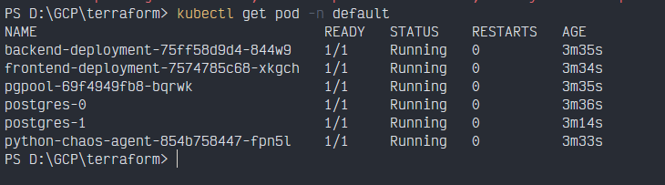
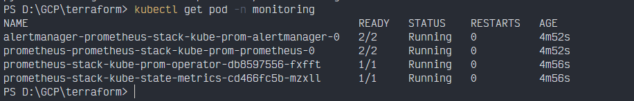
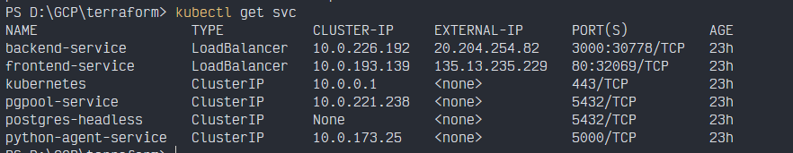

# Setup Guide

Deploy the whole platform (Azure infrastructure, secrets, access and application) with **one `terraform apply` and one workflow run**. No manual cloud steps.

## What you need

- Azure subscription where you are **Owner** (Terraform creates role assignments)
- [Azure CLI](https://learn.microsoft.com/cli/azure/install-azure-cli), [Terraform](https://developer.hashicorp.com/terraform/install) ≥ 1.5,

- A **Groq API key**
- A **GitHub fine-grained token** for this repo only, with:
  - **Contents**: Read and write
  - **Variables**: Read and write
  - **Metadata**: Read

## Setup

**1. Fill in your values.** Copy the example file, then edit it (`terraform.tfvars` is git-ignored):

```powershell
cd terraform

```

| Variable | Value |
|---|---|
| `subscription_id`, `tenant_id` | From `az account show` |
| `github_repo` | `<user_name>/<repo>`, exact case |
| `db_root_password`, `pg_repl_password`, `pgpool_admin_password` | Passwords of your choice |
| `groq_api_key`, `github_token` | The two keys above |

**2. Provision.** Run these from the `terraform` folder:

```powershell
az login
az account set --subscription "<SUBSCRIPTION_ID>"
terraform init
terraform plan -var-file="terraform.tfvars"
terraform apply -var-file="terraform.tfvars"
```

Type `yes` when asked. It takes about 15 minutes. (`terraform.tfvars` is also picked up automatically, but `-var-file` is required if you name your file differently, for example `secrets.tfvars`.)

What each Terraform file does:

| File | What it does |
|---|---|
| `provider.tf` | Terraform and provider versions (Azure, GitHub, time) and the GitHub login |
| `variables.tf` | All inputs, including the sensitive ones you fill in `terraform.tfvars` |
| `main.tf` | Core resources: resource group, AKS cluster, Key Vault, container registry |
| `iam.tf` | Managed identities, OIDC trust for GitHub Actions, Workload Identity for pods, and their roles |
| `access.tf` | Two extra roles: AKS pulls images from ACR, and the Key Vault add-on reads secrets |
| `secrets.tf` | Writes the three Key Vault secrets (waits 90 s for roles to propagate first) |
| `github.tf` | Publishes IDs and names as GitHub Actions variables for the workflow |
| `outputs.tf` | Prints useful values (client ID, tenant ID, ACR server, cluster name) |
| `terraform.tfvars.example` | Template for your own `terraform.tfvars` |

**3. Deploy.** In GitHub, open **Actions → Build and Deploy 3-Tier App → Run workflow** on the `main` branch. It builds the images, pushes them to ACR and deploys everything (about 10 to 15 minutes).

**4. Verify.**

```powershell
az aks get-credentials --resource-group <ResourceGroupName> --name <ClusterName>
kubectl get pods -n default          # all Running
kubectl get pods -n monitoring       # all Running
kubectl get svc frontend-service     # EXTERNAL-IP = dashboard URL
```







Open `http://<EXTERNAL-IP>` for the dashboard, then try a scenario from the chaos section.

## Good to know

| Detail | Why it matters |
|---|---|
| Run the workflow from **`main`** | The OIDC trust only accepts that branch |
| Run `terraform apply` **before** the workflow | Terraform writes the variables the workflow reads |
| `github_repo` must match the exact case | The OIDC match is case-sensitive |
| Key Vault and ACR names are globally unique | Rename them in `main.tf` if taken |
| Set passwords **before the first deploy** | Postgres applies its password only on first start |
| Don't rename the Helm release `prometheus-stack` | The agent looks up Prometheus by that service name |
| Fixes only work in the `default` namespace | The agent's write permissions stop there; it can read everywhere |
| k6 scripts in `backend/` have a hard-coded IP | Replace it with your `backend-service` external IP |
| `Chaos Testing/chaos.yaml` is not deployed by the workflow | Apply it yourself when you want the dummy pods |
| After changing a secret, re-run `terraform apply` and restart the pods | Pods read secrets once at startup |
| `terraform.tfstate` is local and holds secret values | Keep it out of git; use a remote backend for teams |
| The dashboard and agent have no login, and the services are public | Use for demos only; restrict access before real use |

## Troubleshooting

| Error | Fix |
|---|---|
| `403 Resource not accessible by personal access token` | Add the **Variables** permission to the token |
| "No matching federated identity" at login | Run from `main` and check `github_repo` case |
| `ImagePullBackOff` or secret mount `403` | Roles can take a few minutes to propagate; delete the pod to retry |
| `terraform apply`: "already exists" | Created by hand earlier; `terraform import` it |

## Cleanup

```powershell
cd terraform
terraform destroy -var-file="terraform.tfvars"
```

The Key Vault is soft-deleted, so its name stays reserved. To reuse the name, purge it first: `az keyvault purge --name <vault-name>`.