## Architecture Overview


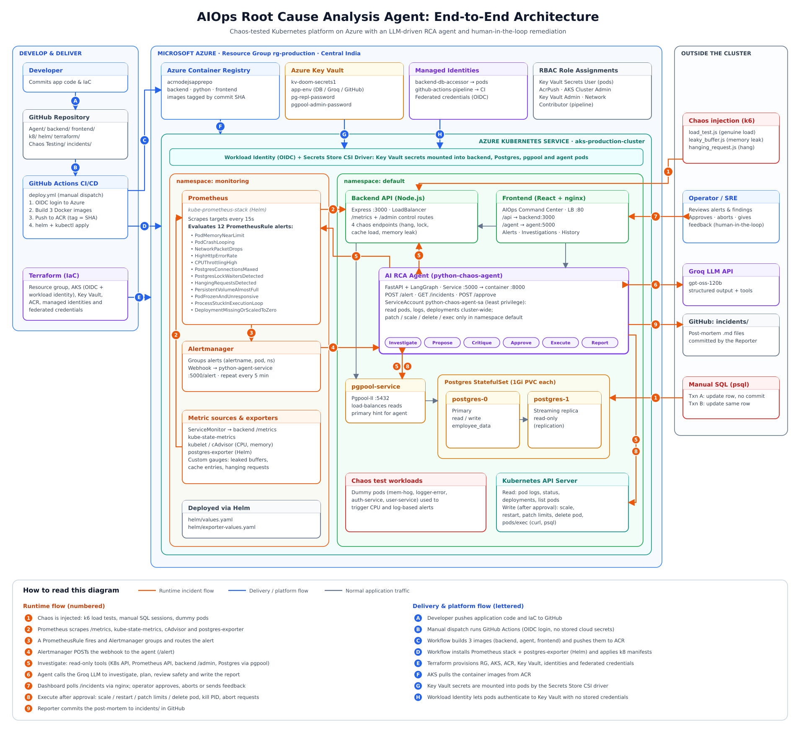


## Agentic workflow


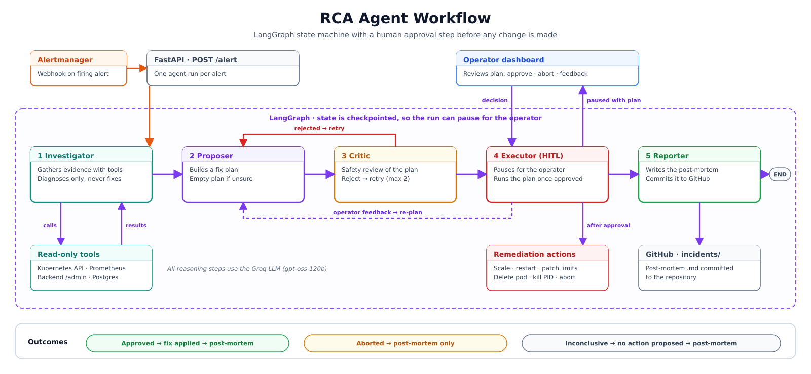


## Chaos Engineering: Tested Failure Scenarios

To validate the Root Cause Analysis (RCA) agent, failures were **intentionally injected** into the system (chaos engineering) and the agent was observed end to end. Each scenario follows the same loop:

1. **Inject the failure** (k6 load test, manual SQL sessions, or a dummy pod).
2. **Prometheus detects it** and Alertmanager sends the alert to the agent.
3. **Investigator** gathers evidence using read-only tools (pod logs, pod status, memory trends, Postgres lock views, in-flight requests).
4. **Proposer + Critic** build a remediation plan and review it for safety.
5. **Human-in-the-loop (HITL)**: the agent pauses and waits for the operator to *approve*, *abort*, or *give feedback*.
6. **Executor** applies the approved action, and the **Reporter** commits a post-mortem to `incidents/`.

### Scenario summary


| # | Scenario | How it was triggered | Alert | Agent outcome |
|---|----------|----------------------|-------|---------------|
| 1 | Genuine memory load | k6 `backend/load_test.js` | `PodMemoryNearLimit` | Increase memory limit |
| 2 | Memory leak | k6 `backend/leaky_buffer.js` | `PodMemoryNearLimit` | Restart deployment |
| 3 | Blocking DB transaction | Two manual `psql` sessions | `PostgresLockWaitersDetected` | Terminate blocking PID |
| 4 | Hanging requests | k6 `backend/hanging_request.js` | `HangingRequestsDetected` | Abort hanging requests |
| 5 | Operator feedback override | Re-plan during HITL | Any | Plan updated with operator's value |
| 6 | Insufficient evidence | Idle-in-transaction alert while the DB was unreachable to the agent | Idle-in-transaction alert | Inconclusive, no action proposed |
| 7 | CPU limit exceeded (known gap) | Dummy `mem-hog` pod | CPU alerts | No context gathered, no plan |
| 8 | Frozen pod (running but not ready) | Standalone `busybox` pod in `default`; readiness file removed with `kubectl exec` | `PodFrozenAndUnresponsive` | Usually low confidence, no action; sometimes `delete_pod` after approval |


---

### 1. Genuine memory load

**What is simulated:** a legitimate traffic increase. k6 ramps up requests to `/api/catalog/lookup`, which stores 1 MB entries in a **bounded cache** (max entries plus a TTL sweep). Memory climbs with the request rate, plateaus, and drops again once load stops.

**How the agent handles it:** the `PodMemoryNearLimit` alert fires and the investigator calls `get_memory_trend`. It sees memory rising *in step with the request rate*, cache entries levelling off, and no runaway buffer growth. It concludes this is real demand, not a leak, so the proposed fix is **`increase_memory_limit`** (raised moderately above the current limit) instead of a restart.

<!-- 📸 SCREENSHOTS: (a) k6 run / memory graph, (b) alert in the dashboard, (c) investigation findings, (d) HITL plan awaiting approval, (e) post-execution result -->
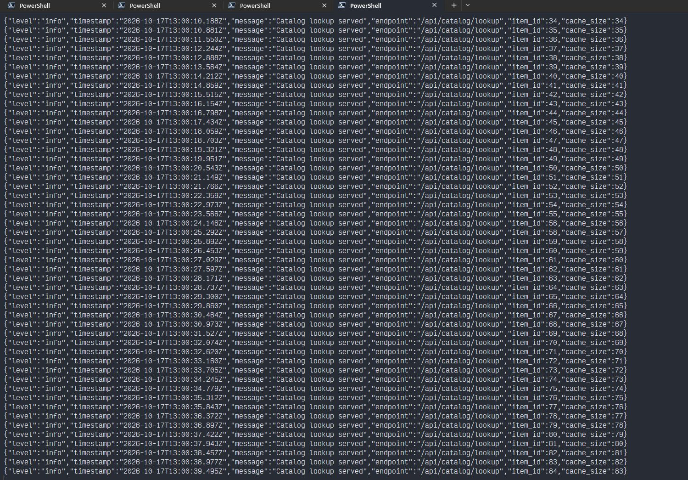


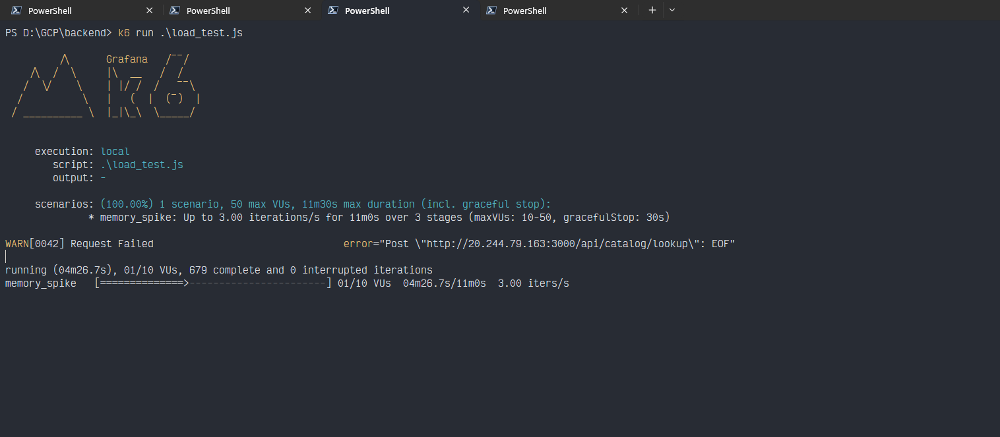

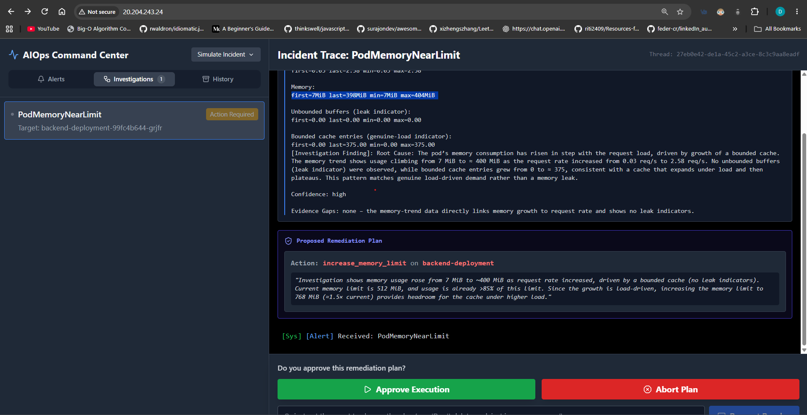

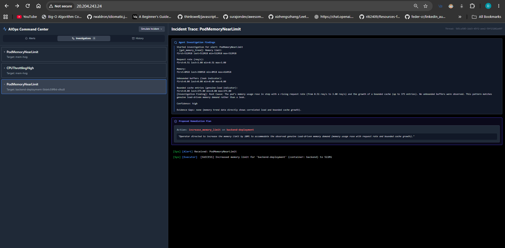


<br/><br/><br/><br/><br/><br/>

---

### 2. Memory leak (leaky buffer)

**What is simulated:** a classic leak. k6 hits `/api/reports/export` at a steady rate, and every call allocates a 100 KB buffer that is kept forever and never evicted. Memory grows regardless of load and never comes back down.

**How the agent handles it:** this raises the **same `PodMemoryNearLimit` alert** as scenario 1, so the agent has to tell the two apart. `get_memory_trend` shows the unbounded-buffer gauge climbing continuously and memory never falling. It identifies a leak, and since raising the limit would only delay the next failure, it proposes **`restart_deployment`**.

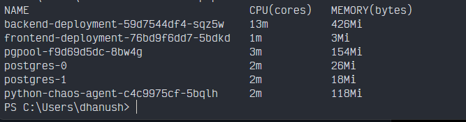

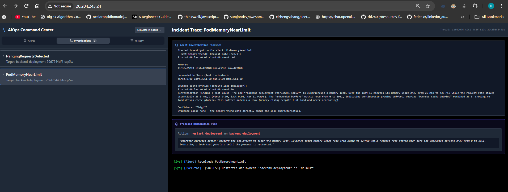

<br/><br/><br/><br/><br/><br/>

---

### 3. Blocking database transaction

**What is simulated:** a lock contention incident, reproduced by hand in two `psql` sessions against Postgres:

- **Session A** opens a transaction, updates a row, and **never commits**, so it holds the row lock.
- **Session B** tries to update the **same row** and waits behind it.

**How the agent handles it:** `PostgresLockWaitersDetected` fires. The investigator runs `get_blocking_transactions` and `get_idle_in_transaction` and finds the blocking PID, the blocked query, and how long the lock has been held. Because the cause is a hoarding transaction (not a lack of resources), the agent avoids scaling or raising limits and proposes **`kill_blocking_transaction`** for that specific PID.

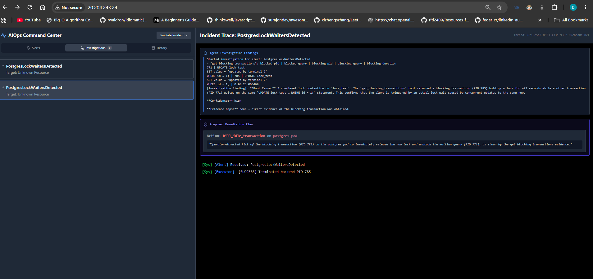

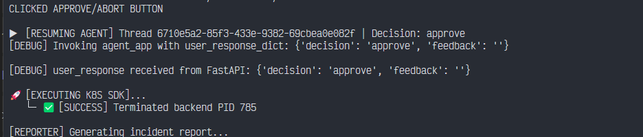

<br/><br/><br/><br/><br/><br/>

---

### 4. Hanging requests

**What is simulated:** a third-party dependency that never responds. k6 sends several concurrent requests to `/api/payments/process`, which deliberately stalls for minutes.

**How the agent handles it:** the backend tracks in-flight requests and exposes a gauge of those older than 10 seconds, which triggers `HangingRequestsDetected`. The investigator calls `fetch_hanging_requests` and `fetch_filtered_pod_logs`, and finds the stuck endpoint along with the "request exceeded hang threshold" log lines. After approval, the executor runs **`abort_hanging_requests`**, which calls the backend's admin endpoint inside the pod. The stuck requests are cancelled and the clients receive a `504`.

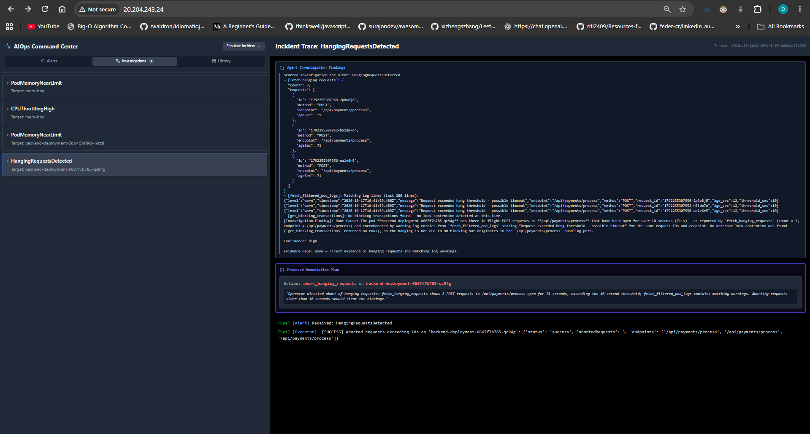

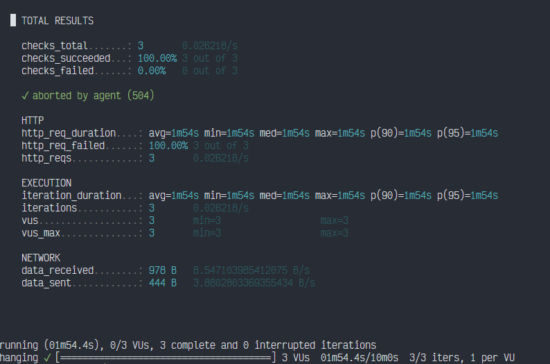

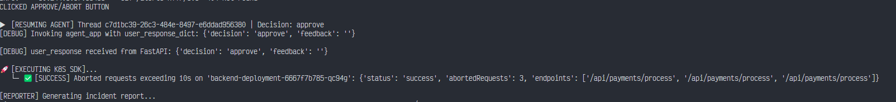

<br/><br/><br/><br/><br/><br/>

---

### 5. Operator feedback (human override)

**What is simulated:** the operator disagrees with the plan. For example, the agent proposes a memory limit, and the operator replies with a **different value** through the feedback box instead of approving.

**How the agent handles it:** the feedback is sent back to the proposer as the **main directive**. The agent builds a new plan using the operator's value, the critic reviews it (as advice only), and the flow pauses again for approval. Nothing runs until the human approves the revised plan.

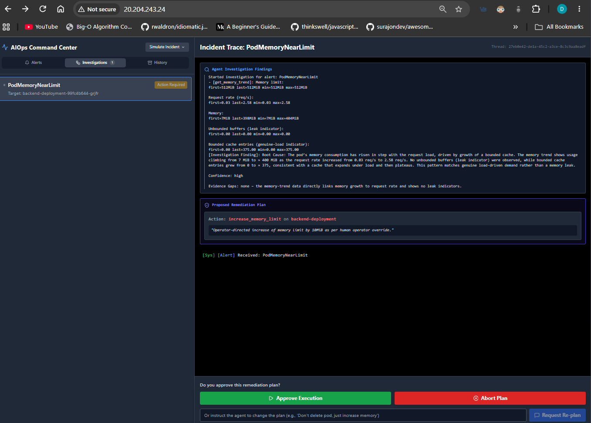

<br/><br/><br/><br/><br/><br/>

---

### 6. Insufficient evidence (inconclusive, no action)

**What is simulated:** an idle-in-transaction incident where the agent **cannot gather enough context**. In this run the investigator was unable to reach the pgpool service, so every database tool (blocking transactions, idle-in-transaction connections) failed.

**How the agent handles it:** a failed tool is treated as an **evidence gap**, never as proof about the database. With nothing concrete to cite, the agent does not guess a cause or invent a fix. The investigator reports low confidence, the proposer returns **`inconclusive` with an empty action list**, and the critic and approval steps are skipped because there is nothing to review or execute. The reporter still writes a post-mortem that records what was attempted, which evidence was missing, and the follow-up steps for the on-call engineer.

This is the safety behaviour the agent is designed around: **no evidence, no claim, no action**.


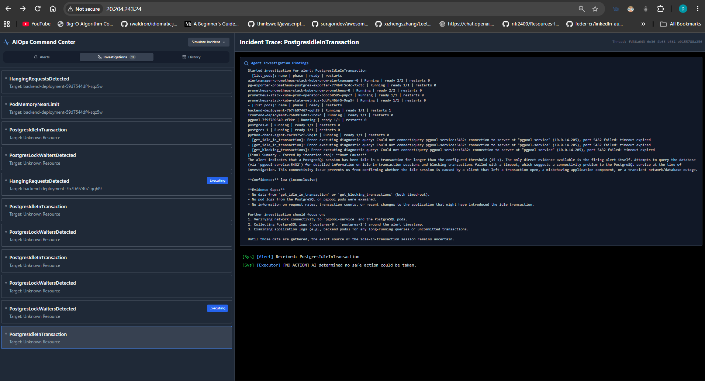


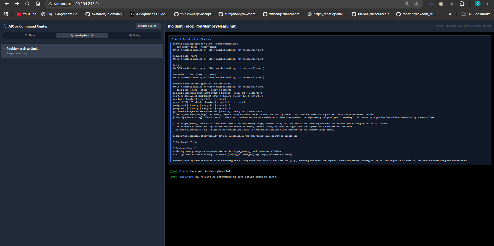

<br/><br/><br/><br/><br/><br/>

---

### 7. CPU limit exceeded (known limitation)

**What is simulated:** a dummy pod (`mem-hog`) deployed to push a container past its CPU limit.

**What happens:** the CPU alerts fire, but the investigator currently has **no CPU-related tools** (its tools cover logs, pod and deployment status, memory trends, Postgres locks, and in-flight requests). Without CPU metrics it cannot gather useful context in the first step, so it cannot reach a root cause and **proposes no remediation**.

**Planned improvement:** add a CPU trend tool (usage vs. limit, throttling ratio) so CPU incidents can be investigated like the memory cases.

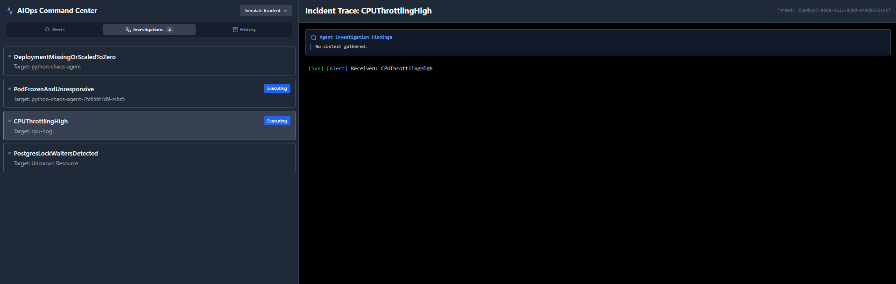

<br/><br/><br/><br/><br/><br/>


### 8. Frozen pod (running but not ready)


**What is simulated:** A pod that is still `Running` but has stopped serving traffic. (ex; nodejs application still running but something blocked the eventloop)

A standalone `busybox` pod named `frozen-pod` is created in the `default` namespace with a readiness probe that checks for the file `/tmp/ready`. Once the pod reaches `1/1` Ready, deleting that file with `kubectl exec` causes the readiness probe to fail. The pod remains running but transitions to `0/1` Ready.

The test runs in `default` intentionally. The agent can **read pods cluster-wide**, but its **remediation permissions** (delete pod, patch, and exec) are scoped to the `default` namespace.

<details>
<summary><strong>Reproduce it (PowerShell)</strong></summary>

**Step 1: Create a pod that starts healthy**

The readiness probe checks whether `/tmp/ready` exists.

```powershell
'{"apiVersion":"v1","kind":"Pod","metadata":{"name":"frozen-pod"},"spec":{"containers":[{"name":"frozen-pod","image":"busybox:1.36","command":["sh","-c","touch /tmp/ready; sleep 86400"],"readinessProbe":{"exec":{"command":["cat","/tmp/ready"]},"periodSeconds":5,"failureThreshold":1}}]}}' | kubectl apply -n default -f -
```

**Step 2: Wait until the pod is `1/1` Ready**

```powershell
kubectl wait --for=condition=Ready pod/frozen-pod -n default --timeout=60s
```

**Step 3: Break the readiness probe**

Delete `/tmp/ready`. The pod should remain `Running` but become `0/1` Ready.

```powershell
kubectl exec -n default frozen-pod -- rm /tmp/ready
kubectl get pod frozen-pod -n default
```

**Step 4: Wait for the alert**

Wait at least 3 minutes. The alert transitions from `Pending` to `Firing` and is sent to the agent.

**Cleanup: Delete only the test pod**

```powershell
kubectl delete pod frozen-pod -n default --ignore-not-found
```

**Important:** Do not delete the namespace.

</details>

#### How the Agent Handles It

The `PodFrozenAndUnresponsive` alert fires when a pod is `Running` but its container has not been ready for 3 minutes.

The investigator uses the following tools:

- `list_pods`
- `get_pod_status`
- `fetch_filtered_pod_logs`
- Request and database checks

The agent finds a running container with `ready: false`, no restarts, and no error logs. The container is alive, but it is not serving traffic.

Because this evidence does not directly establish the root cause, the outcome **varies between runs**.

| Outcome | Frequency | What Happens |
| --- | --- | --- |
| **Low confidence — no action** | Most runs | The plan is empty. The run ends with a post-mortem listing manual checks, such as `kubectl describe pod`, probe configuration, and metrics. |
| **Medium confidence — `delete_pod`** | Some runs | The plan is handed to the operator. Once approved, the pod is deleted and the alert clears. |

#### Why the Outcome Varies

**1. Limited evidence**

`ready: false` is a symptom, not a root cause. The agent cannot inspect Kubernetes events, so it cannot directly confirm the readiness probe failure. Whether the available evidence establishes a clear root cause becomes a judgment call for the model.

**2. Conservative remediation**

The prompts instruct the agent not to guess, to avoid action without a clear cause, and to treat `delete_pod` as a last resort. Therefore, the default outcome is low confidence with no action.

**3. LLM randomness**

The model runs at temperature `0.1` and may call different tools across runs. In one medium-confidence run, it also looked up a Deployment and received a `404`. Its reasoning that nothing existed to restart contributed to the decision to delete the pod.

**Safety principle:** Handing the incident to a human when evidence is weak is intentional. The agent prefers a manual investigation over deleting a pod based on a guess.

#### Planned Improvement

Add a pod-events tool and grant the agent read access to Kubernetes events. This would provide direct evidence of the readiness probe failure and should make the investigation more consistent across runs.


#### Important Note

The test pod is standalone, so Kubernetes does not recreate it after deletion. If the same failure occurs in a Deployment-managed pod, the Deployment controller automatically creates a replacement.

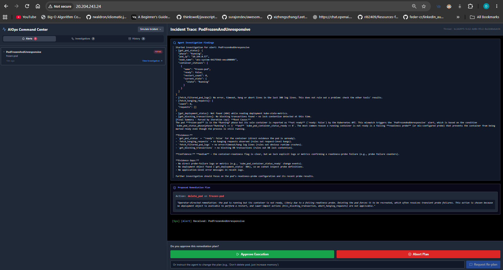


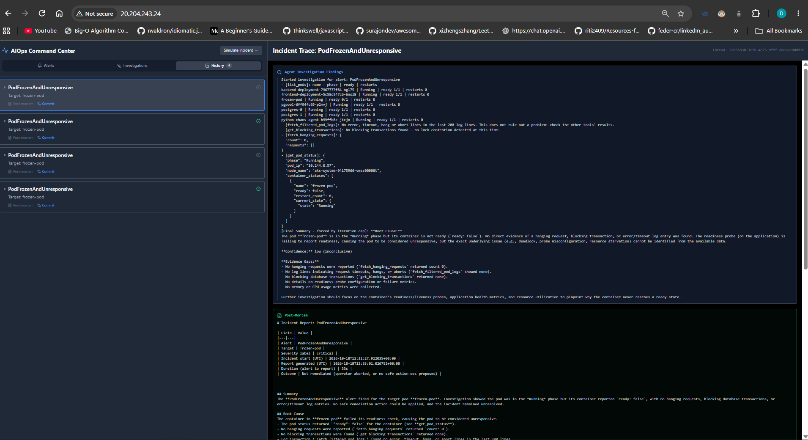


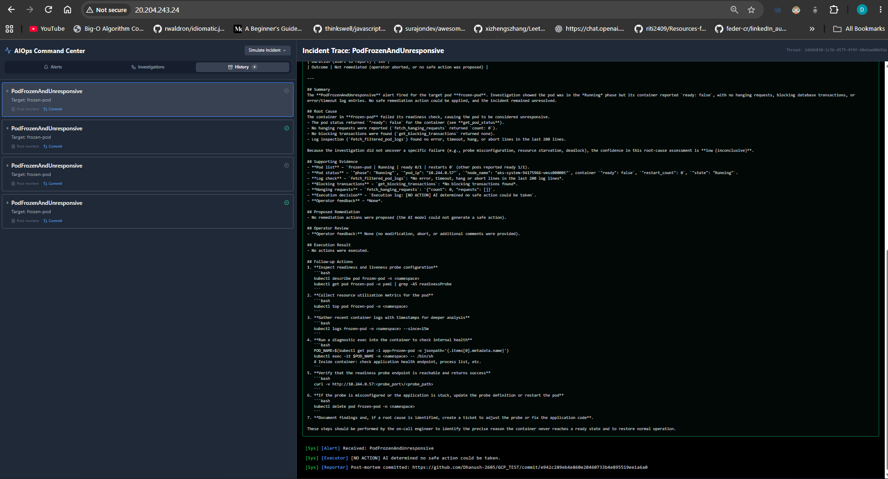


#### Incident Reports

Every run commits its post-mortem report to the `incidents/` directory.

Examples:

https://github.com/Dhanush-2605/GCP_TEST/blob/main/incidents/20261017-163343-cputhrottlinghigh.md

https://github.com/Dhanush-2605/GCP_TEST/blob/main/incidents/20261017-163755-podmemorynearlimit.md

https://github.com/Dhanush-2605/GCP_TEST/blob/main/incidents/20261017-164405-hangingrequestsdetected.md

https://github.com/Dhanush-2605/GCP_TEST/blob/main/incidents/20261017-125340-postgreslockwaitersdetected.md

https://github.com/Dhanush-2605/GCP_TEST/blob/main/incidents/20261017-163055-podmemorynearlimit.md

https://github.com/Dhanush-2605/GCP_TEST/blob/main/incidents/20261018-125214-podfrozenandunresponsive.md


What is simulated: a pod that is still Running but has stopped serving traffic. A standalone busybox pod (frozen-pod) is created in the default namespace with a readiness probe that checks for the file /tmp/ready. Once it is 1/1 Ready, deleting that file with kubectl exec makes the probe fail: the pod keeps running, but drops to 0/1 Ready.

The test runs in default on purpose. The agent can read pods cluster-wide, but its remediation permissions (delete pod, patch, exec) are scoped to the default namespace.

<details> <summary><b>Reproduce it (PowerShell)</b></summary>
Create a pod that starts healthy (the readiness probe checks /tmp/ready):
powershell

'{"apiVersion":"v1","kind":"Pod","metadata":{"name":"frozen-pod"},"spec":{"containers":[{"name":"frozen-pod","image":"busybox:1.36","command":["sh","-c","touch /tmp/ready; sleep 86400"],"readinessProbe":{"exec":{"command":["cat","/tmp/ready"]},"periodSeconds":5,"failureThreshold":1}}]}}' | kubectl apply -n default -f -


Wait until it is 1/1 Ready:

powershell
kubectl wait --for=condition=Ready pod/frozen-pod -n default --timeout=60s
Break it (the pod stays Running but becomes 0/1):
powershell
kubectl exec -n default frozen-pod -- rm /tmp/ready
kubectl get pod frozen-pod -n default
Wait 3+ minutes. The alert goes Pending → Firing and is sent to the agent.

Cleanup (only the test pod, never the namespace):

powershell
kubectl delete pod frozen-pod -n default --ignore-not-found
</details>

How the agent handles it: PodFrozenAndUnresponsive fires when a pod is in the Running phase but its container has not been ready for 3 minutes. The investigator uses list_pods, get_pod_status and fetch_filtered_pod_logs, and finds a running container reporting ready: false, with no restarts (so it is not crash-looping) and no error output in its logs: alive, but not serving. None of the lower-impact fixes applies (no blocking query, leak or hanging request, and a standalone pod has no deployment to restart), so the proposer falls back to the last-resort action, delete_pod, and the plan waits for operator approval.

Notes:

The agent reads pod phase, container readiness, restart count and logs. It does not read Kubernetes events, so the failing readiness probe is inferred from the not-ready state rather than quoted directly.
The test pod is standalone, so nothing recreates it after deletion. With a Deployment-managed pod, the replacement would start automatically.


<br/><br/><br/><br/><br/><br/>


Incidents:

https://github.com/Dhanush-2605/GCP_TEST/blob/main/incidents/20261017-163343-cputhrottlinghigh.md

